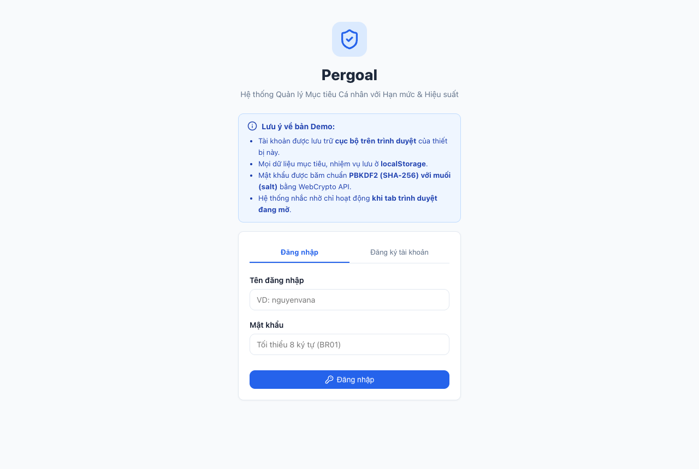
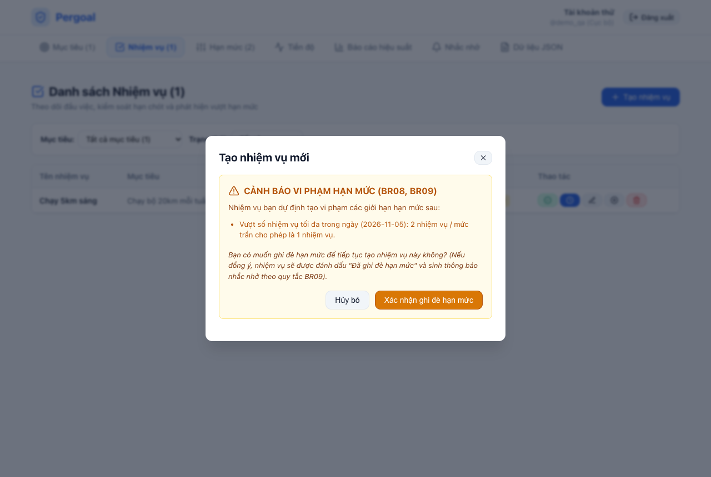
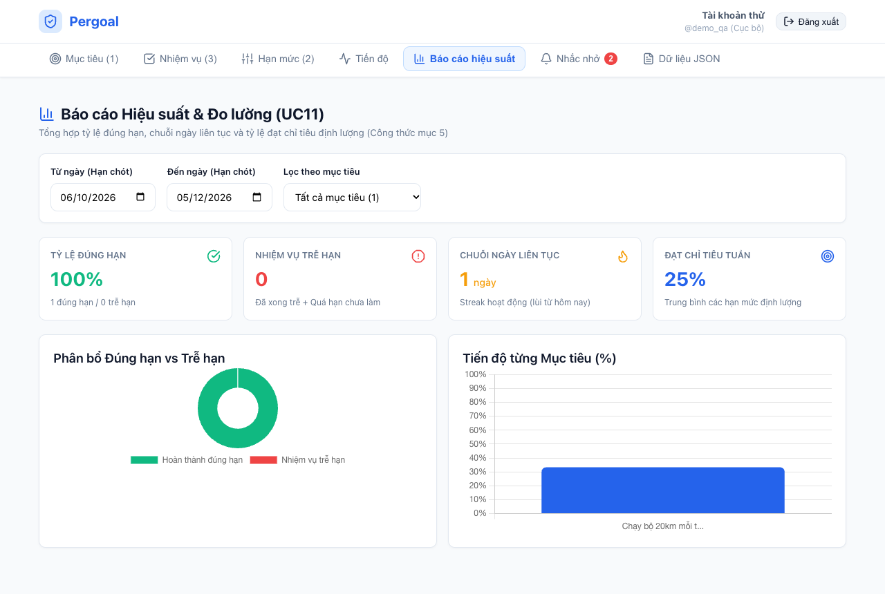
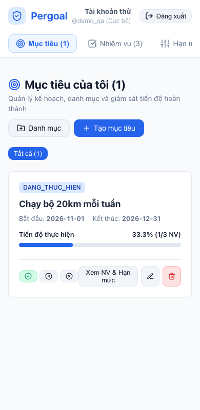

# Pergoal — Bản demo quản lý mục tiêu

Pergoal là ứng dụng quản lý mục tiêu cá nhân: đặt mục tiêu có thời hạn, chia thành nhiệm vụ, tự đặt **hạn mức** (hạn chót, số nhiệm vụ/ngày, số giờ/tuần, chỉ tiêu định lượng) và theo dõi **hiệu suất** tính từ dữ liệu thật.

Đây là bản demo cho Báo cáo lần 1 môn Phân tích thiết kế hướng đối tượng. Ứng dụng chạy **hoàn toàn phía client** (Vite + React + TypeScript), dữ liệu lưu trong `localStorage` của trình duyệt.

## 1. Yêu cầu môi trường

- Node.js 20 trở lên (workflow GitHub Actions dùng Node 20).
- npm đi kèm Node.

## 2. Chạy tại máy

```bash
cd web
npm ci
npm run dev
```

Mở địa chỉ Vite in ra (mặc định `http://localhost:5173/pergoal/`).

Build và xem thử bản tĩnh:

```bash
npm run build
npm run preview
```

## 3. Kiểm thử

```bash
npm test        # tương đương npx vitest run
```

Bộ test hiện có:

| Tệp | Nội dung |
|---|---|
| `src/domain/__tests__/BoTinhHieuSuat.test.ts` | Công thức hiệu suất: tỉ lệ đúng hạn (kể cả mẫu số 0), nhiệm vụ trễ, tiến độ mục tiêu, phần trăm đạt chỉ tiêu, chuỗi ngày liên tục; biên cùng ngày, ranh giới tuần thứ Hai – Chủ nhật, hôm nay chưa có hoạt động |
| `src/domain/__tests__/BoKiemTraHanMuc.test.ts` | BR08: vượt DEADLINE, số nhiệm vụ/ngày, số giờ/tuần; nhiệm vụ `DA_HUY` bị loại; cập nhật bỏ qua chính bản ghi; BR10 không hồi tố, không sửa dữ liệu |
| `src/controller/__tests__/BR09.test.ts` | BR09: cảnh báo trước khi ghi, một nhắc `VUOT_HAN_MUC` cho mỗi hạn mức bị vi phạm, áp dụng khi cập nhật nhiệm vụ |

## 4. Cấu trúc mã nguồn

```
web/
├── index.html
├── public/
│   ├── icon.svg
│   └── manifest.webmanifest        # PWA: cài như ứng dụng
├── src/
│   ├── main.tsx
│   ├── App.tsx                     # khung ứng dụng, điều hướng, bộ định thời nhắc nhở
│   ├── index.css
│   ├── domain/                     # entity + logic thuần, không phụ thuộc React
│   │   ├── types.ts
│   │   ├── BaoMat.ts               # PBKDF2 + salt qua WebCrypto
│   │   ├── BoKiemTraHanMuc.ts      # BR08/BR10
│   │   ├── BoTinhHieuSuat.ts       # công thức hiệu suất
│   │   └── KhoDuLieu.ts            # bọc localStorage, xuất/nhập JSON
│   ├── controller/                 # điều phối thao tác hệ thống
│   │   ├── TaiKhoanController.ts
│   │   ├── MucTieuController.ts
│   │   ├── NhiemVuController.ts
│   │   ├── HanMucController.ts
│   │   ├── TienDoController.ts
│   │   ├── BaoCaoController.ts
│   │   ├── NhacNhoController.ts
│   │   └── DuLieuController.ts
│   └── boundary/                   # component React ManHinh*
│       ├── ManHinhTaiKhoan.tsx
│       ├── ManHinhMucTieu.tsx
│       ├── ManHinhNhiemVu.tsx
│       ├── ManHinhHanMuc.tsx
│       ├── ManHinhTienDo.tsx
│       ├── ManHinhBaoCao.tsx
│       ├── ManHinhNhacNho.tsx
│       └── ManHinhDuLieu.tsx
├── .github/workflows/deploy.yml    # test + build + deploy GitHub Pages
├── package.json
├── tsconfig.json
└── vite.config.ts                  # base: '/pergoal/'
```

Phân lớp theo Boundary–Controller–Entity. `BoKiemTraHanMuc` và `BoTinhHieuSuat` là code thuần, nhận `homNay` làm tham số để kiểm thử độc lập, không phụ thuộc React hay `localStorage`.

## 5. Chức năng của bản demo

| Mã | Chức năng | Trạng thái |
|---|---|---|
| UC01–UC03 | Đăng ký, đăng nhập, đăng xuất tài khoản cục bộ | Có |
| UC04–UC06 | Tạo, sửa, đổi trạng thái, xoá mục tiêu; quản lý danh mục | Có |
| UC07–UC08 | Tạo, sửa, huỷ, xoá nhiệm vụ; kiểm tra hạn mức và xác nhận ghi đè | Có |
| UC09 | Thiết lập, xoá bốn loại hạn mức | Có |
| UC10 | Cập nhật tiến độ, hoàn thành nhiệm vụ, ghi nhận chỉ tiêu | Có |
| UC11 | Báo cáo hiệu suất và dashboard biểu đồ (Chart.js) | Có |
| UC12 | Nhắc nhở trong app; Notification API khi tab mở | Có |
| UC13 | Xuất / nhập dữ liệu JSON | Có |
| UC14–UC15 | Quản trị viên, đồng bộ máy chủ | **Không có** — thiết kế giai đoạn sau |

## 6. Dữ liệu và giới hạn

- Tài khoản là **tài khoản cục bộ trên trình duyệt**, chỉ tách dữ liệu giữa các tài khoản trên cùng máy; **không phải cơ chế bảo mật máy chủ** (BR02).
- Mật khẩu được băm **PBKDF2 có salt** bằng WebCrypto, không lưu mật khẩu rõ (BR01).
- Dữ liệu lưu trong `localStorage` với các khoá: `pergoal_users`, `pergoal_session_user`, `pergoal_data_<tenDangNhap>`.
- Xoá dữ liệu trình duyệt sẽ mất dữ liệu. Dùng **Xuất / nhập JSON** (UC13) để sao lưu; nhập tệp sai sẽ bị từ chối và dữ liệu cũ giữ nguyên (BR16).
- Không đồng bộ giữa các thiết bị.
- Nhắc nhở chỉ chạy khi tab đang mở (kiểm tra khi mở app và mỗi 60 giây). Từ chối quyền Notification thì app vẫn hoạt động; nhắc vẫn hiển thị trong app (BR15).
- Không có quản trị viên, email hay máy chủ trong bản demo.

## 7. Triển khai GitHub Pages

Workflow `.github/workflows/deploy.yml` chạy khi push lên nhánh `main` (hoặc chạy tay):

1. `npm ci`
2. `npx vitest run`
3. `npm run build`
4. Upload thư mục `dist` và deploy lên GitHub Pages.

Cấu hình: `vite.config.ts` đặt `base: '/pergoal/'`, vì vậy repository phải có tên `pergoal` (hoặc sửa `base` cho khớp tên repository). Trong **Settings → Pages → Build and deployment**, chọn **Source: GitHub Actions**.

- Bản demo: https://musual-moncra.github.io/pergoal/
- Mã nguồn: https://github.com/Musual-Moncra/pergoal

## 8. Quy ước

- Lớp nghiệp vụ dùng tên tiếng Việt không dấu đúng theo Bảng thuật ngữ và quy tắc: `MucTieu`, `NhiemVu`, `HanMuc`, `taoMucTieu`, `BoTinhHieuSuat`…
- Component React dùng tiền tố `ManHinh*`; phần phụ trợ dùng tiếng Anh.
- Không ghi tên thật, thông tin cá nhân, mật khẩu hay token vào mã nguồn.

## Ảnh chụp

Ảnh từ bản demo với dữ liệu thử.





